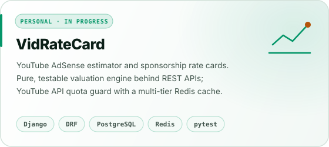
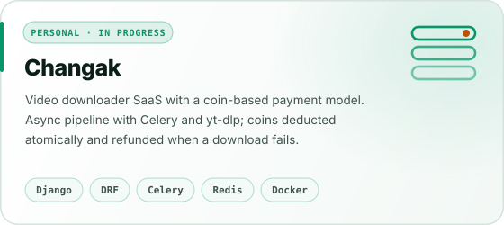
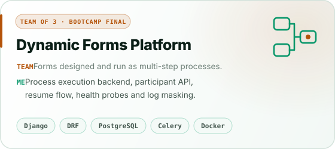
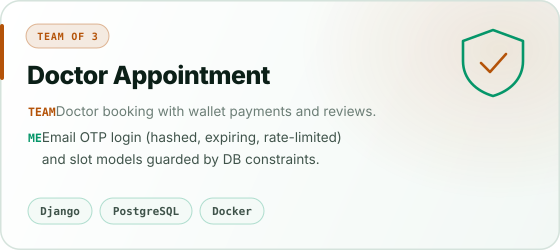
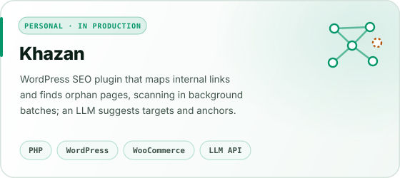
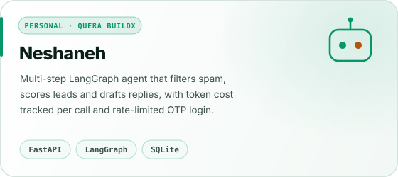

<p align="center">
  <picture><source media="(prefers-color-scheme: dark)" srcset="./assets/banner-dark.svg" /></picture>
</p>

<p align="center">
  <a href="https://linkedin.com/in/amirrezaparvaneh"></a>
  <a href="mailto:amirreza.parvaneh99@gmail.com"></a>
  <a href="https://stackoverflow.com/users/33002906"></a>
  
</p>

## `GET /me`

```jsonc
// 200 OK
{
  "name": "Amirreza Parvaneh",
  "role": "Junior Software Engineer",
  "focus": ["backend services", "REST APIs", "async jobs", "testing"],
  "stack": ["Python", "Django", "DRF", "PostgreSQL", "Redis", "Celery", "Docker"],
  "location": "Tabriz, Iran",
  "open_to": "junior backend roles, on-site or remote"
}
```

I build backend services and REST APIs with **Python, Django and Django REST Framework**. I learned to work in a team during the **Quera Software Engineering Bootcamp**: branches, pull requests, code review and tests on every change. Since then I keep shipping my own products.

Before backend, I worked in **technical SEO**. That is where I learned to care about speed, clean structure and how software behaves once real users hit it.

## Featured work

<p align="center">
  <a href="https://github.com/amirrezaparvaneh/VidRateCard"><picture><source media="(prefers-color-scheme: dark)" srcset="./assets/card-vidratecard-dark.svg" /></picture></a>
  <a href="https://github.com/amirrezaparvaneh/changak"><picture><source media="(prefers-color-scheme: dark)" srcset="./assets/card-changak-dark.svg" /></picture></a>
</p>

<p align="center">
  <a href="https://github.com/SARD-81/dynamic-forms-platform"><picture><source media="(prefers-color-scheme: dark)" srcset="./assets/card-dynamic-forms-dark.svg" /></picture></a>
  <a href="https://github.com/SARD-81/doctor-appointment-system"><picture><source media="(prefers-color-scheme: dark)" srcset="./assets/card-doctor-appointment-dark.svg" /></picture></a>
</p>

<p align="center">
  <a href="https://github.com/amirrezaparvaneh/wp-internal-link-analyzer"><picture><source media="(prefers-color-scheme: dark)" srcset="./assets/card-khazan-dark.svg" /></picture></a>
  <a href="https://github.com/amirrezaparvaneh/ai-lead-generation-agent"><picture><source media="(prefers-color-scheme: dark)" srcset="./assets/card-neshaneh-dark.svg" /></picture></a>
</p>

<p align="center"><sub>
  <b>Personal</b> = built by me end to end · <b>Team</b> = the <code>ME</code> line is my own part, the rest is the team's work
</sub></p>

## Where I've worked

| Role | Where | When |
| :-- | :-- | :-- |
| **Technical SEO Specialist** | Aka Leather · on-site, Tabriz | Aug 2026 – present |
| **Technical SEO Specialist** (freelance) | Dandak online store · remote | 2022 – 2025 |

At Aka Leather I designed and built **Khazan**, an in-house internal linking plugin that now runs on the live store.

## Toolbox

<p align="center">
  <a href="https://skillicons.dev"></a>
</p>

| | |
| :-- | :-- |
| **Backend** | Django · Django REST Framework · FastAPI · REST API design · OpenAPI / Swagger |
| **Data & async** | PostgreSQL · Redis · Celery |
| **Ship & run** | Docker · Docker Compose · Nginx · Linux · GitHub Actions |
| **Quality** | pytest · Django test framework · ruff · black · mypy |
| **Also** | LangGraph · LLM APIs · WordPress plugins · technical SEO |

## How I work

- **Logic lives in services**, not in views. Views stay thin, so the business rules are easy to test.
- **The database protects the data.** Constraints and atomic transactions, not only checks in Python.
- **Slow work goes to a queue.** Celery workers do the heavy jobs; the API answers fast.
- **Tests come with the feature.** ruff, black and mypy keep the code consistent.

<details>
<summary><b>More projects</b></summary>
<br/>

| Project | What it is | Type |
| :-- | :-- | :-- |
| [Japan Earthquake Analysis](https://github.com/SARD-81/japan-earthquake-analysis) | Earthquake data from four sources, cleaned and analyzed. **My part:** PostgreSQL schema, SQL cleaning and analysis stages, heatmaps, deterministic pipeline tests | Team of 4 |
| [Railway Ticketing](https://github.com/SARD-81/railway-ticketing-management-system) | Train and ticket management from the command line | Team |
| [Quera Video Sharing](https://github.com/amirrezaparvaneh/quera_video_sharing) | Video sharing REST API with Django REST Framework | Personal |
| [Django Library Management](https://github.com/amirrezaparvaneh/django-library-management) | Book management with search, auth and private favorites | Personal |
| [Altina](https://github.com/amirrezaparvaneh/altina) | AI-generated image SEO for WordPress | Personal |
| [PriceOrbit](https://github.com/amirrezaparvaneh/PriceOrbit) | WooCommerce price sync with a scraper | Personal |
| [Pixel Jet](https://github.com/amirrezaparvaneh/pixel-jet) | Converts WordPress uploads to WebP / AVIF | Personal |
| [WP Media Deduplicator](https://github.com/amirrezaparvaneh/wp-media-deduplicator) | Finds and safely removes duplicate images in the media library | Personal |

</details>

## Education

- **B.Sc. Software Engineering**, Shiraz University · 2025 – present
- **Associate Degree in Software Engineering**, Islamic Azad University · 2019 – 2022
- **Software Engineering Bootcamp (Python & Django)**, Quera · 2026

<br/>

<p align="center">
  <a href="https://linkedin.com/in/amirrezaparvaneh"></a>
  <a href="mailto:amirreza.parvaneh99@gmail.com"></a>
</p>

<p align="center"><sub>Readable code · honest tests · boring deployments.</sub></p>
